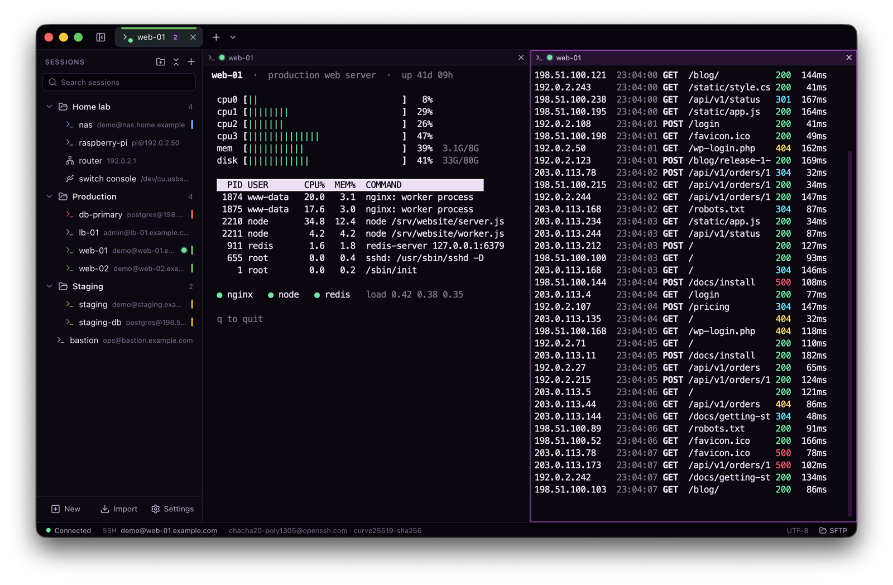
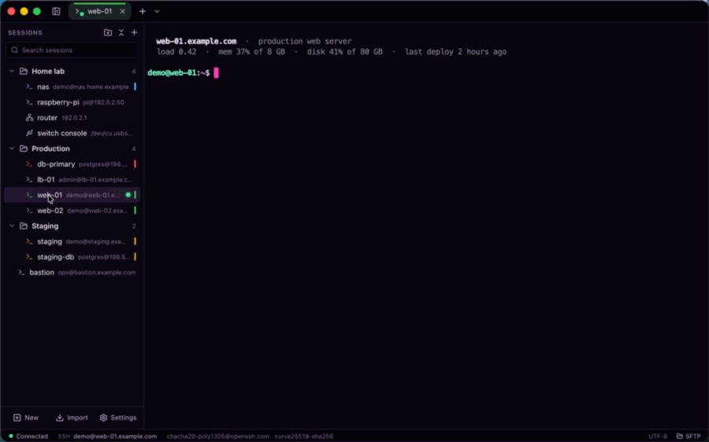
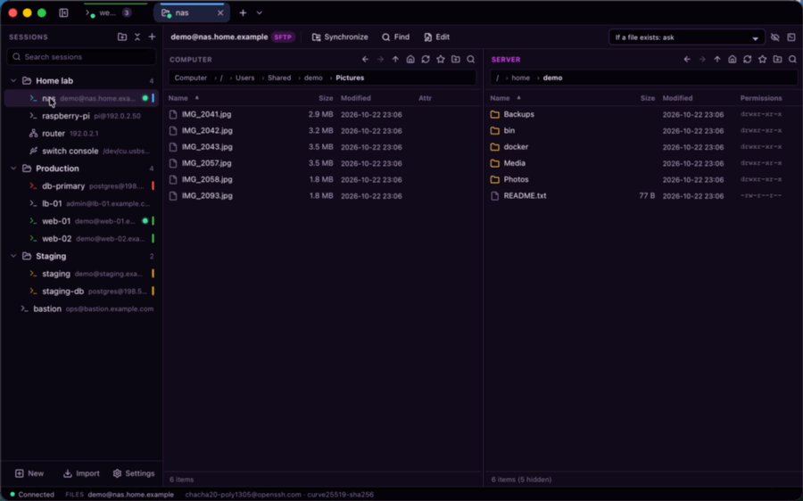
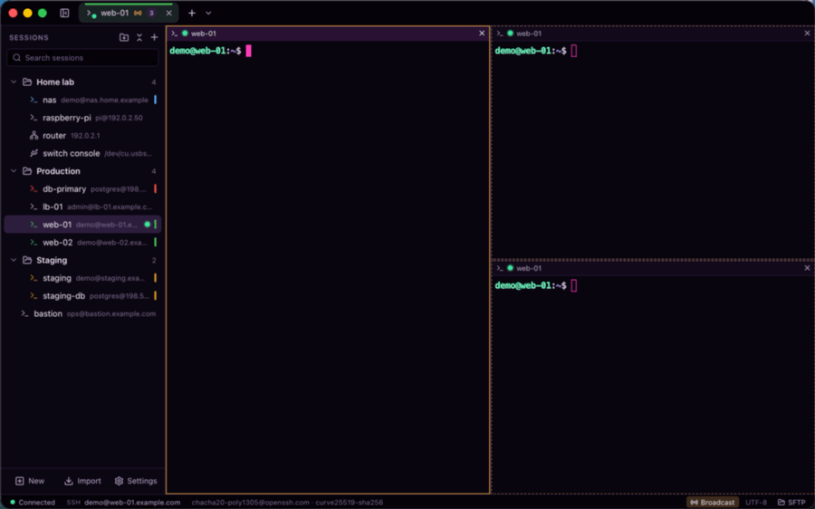
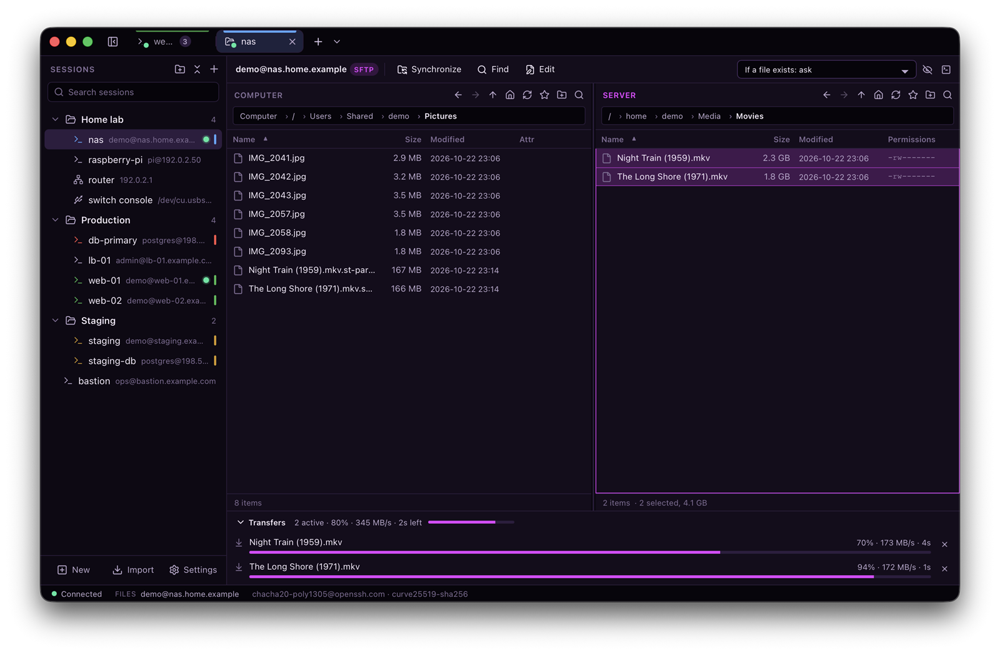
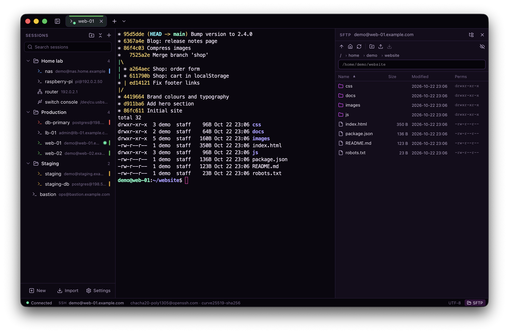
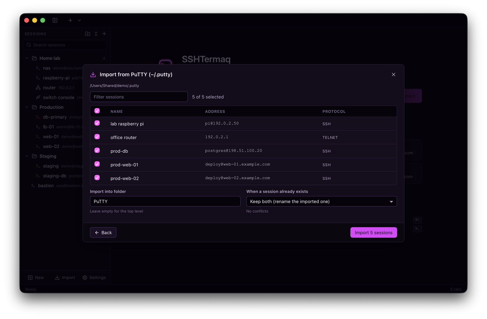
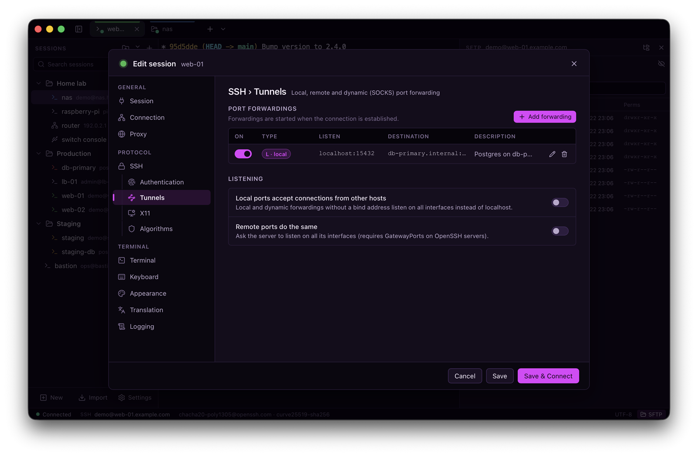
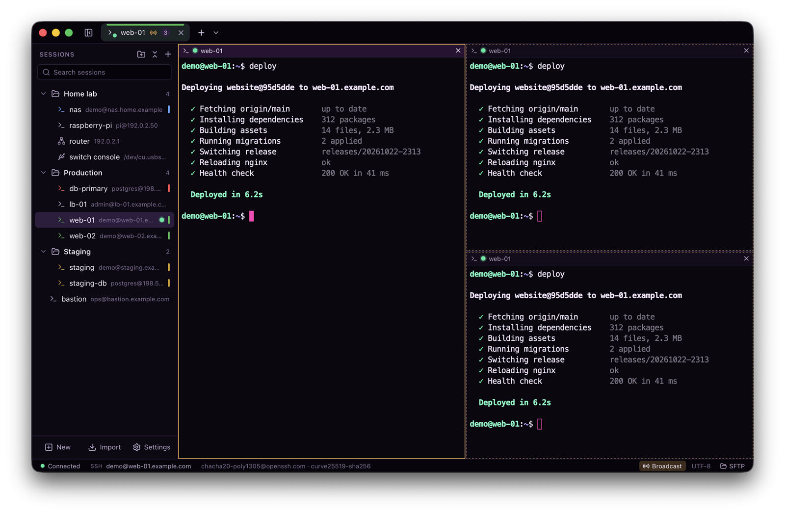
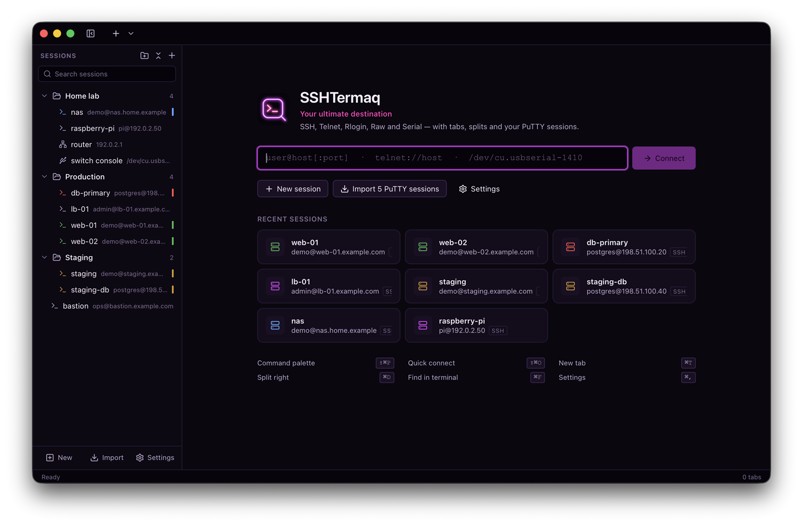

<p align="center">
  
</p>

<h1 align="center">SSHTermaq</h1>

<p align="center">
  <b>A modern, PuTTY-compatible SSH client for Windows and macOS: tabs, split panes and a built-in file manager,
  with your PuTTY sessions imported in one click.</b>
</p>

<p align="center">
  For sysadmins, network engineers and developers who know PuTTY and want the same settings in a modern workspace,
  on the PC and on the Mac. It also speaks Telnet, Rlogin, Raw TCP and serial ports, and opens local shells.
</p>

<p align="center">
  <a href="https://github.com/f1resh/sshtermaq/releases/latest"></a>
  <a href="https://github.com/f1resh/sshtermaq/releases"></a>
  <a href="LICENSE"></a>
  <br>
  <a href="#download"></a>
  <a href="#download"></a>
</p>

<p align="center">
  <a href="#download"><b>Download for Windows and macOS</b></a> ·
  <a href="https://f1resh.github.io/sshtermaq/">Website</a> · free and open source
</p>

<p align="center">
  <a href="https://apps.microsoft.com/detail/9PPK5DXCRQRC"></a>
</p>

<p align="center">
  
</p>

## Why SSHTermaq

- **Everything PuTTY does.** PuTTY's session settings, keyboard modes, `.ppk` keys, Pageant and command-line options.
  Your PuTTY sessions and trusted host keys come over in one click, from the registry, a `.reg` file or `~/.putty`,
  and so do the hosts in `~/.ssh/config`.
- **A modern workspace.** Tabs, split panes, input broadcast to all panes, a command palette, quick connect, sessions
  in folders with search, and your tabs restored at the next start.
- **Local shells next to your servers.** PowerShell, cmd, Git Bash, WSL or zsh in the same tabs and split panes as
  your SSH sessions.
- **A file manager built in.**
  - An SFTP panel next to any SSH terminal, on the terminal's own connection (no second login).
  - A WinSCP-style two-pane tab with drag and drop, a transfer queue, resume, edit-on-server and folder sync.
  - Falls back to SCP on routers and other servers without SFTP.
- **Tunnels and jump hosts.** Local, remote and dynamic (SOCKS) port forwarding, agent and X11 forwarding, jump hosts,
  and SOCKS, HTTP and Telnet proxies.
- **One app on Windows and macOS.**
  - About a 5 MB download, with nothing else to install on Windows 11 or macOS.
  - The macOS app is signed and notarized by Apple.
- **Your look.** 15 app themes, 30 terminal color schemes, a scheme editor and configurable shortcuts.

## See it in action

<p align="center">
  
</p>

| | |
|---|---|
|  |  |
| **File manager:** drag and drop both ways, with the transfer queue | **Broadcast input:** one command, every pane |

## Screenshots

| | |
|---|---|
|  |  |
| **File manager:** this computer and the server side by side, with the transfer queue | **SFTP panel** beside the terminal, on the same connection |
|  |  |
| **PuTTY import:** sessions and host keys in one click | **Session editor:** PuTTY's settings, including tunnels |
|  |  |
| **Split panes** with broadcast input | **Welcome screen:** quick connect and recent sessions |

The screenshots are from macOS; the Windows version looks the same apart from the window buttons. The hosts, users
and files in them are made up.

## Download

| Where | How | Updates |
|---|---|---|
| **Microsoft Store** (Windows 10 1809+ / 11) | [SSHTermaq in the Microsoft Store](https://apps.microsoft.com/detail/9PPK5DXCRQRC) | automatic, by the Store |
| **Homebrew** (macOS 12+) | `brew install --cask f1resh/tap/sshtermaq` | `brew upgrade --cask sshtermaq` |
| **GitHub** (Windows and macOS) | the files of the [latest release](https://github.com/f1resh/sshtermaq/releases/latest), below | download the new version and install it over the old one |

From the command line:

```bash
# macOS (Homebrew)
brew install --cask f1resh/tap/sshtermaq

# Windows: the Microsoft Store version, through winget
winget install --id 9PPK5DXCRQRC --source msstore
```

Updating keeps your sessions and settings. Use one way per PC: the Store version and the installer from GitHub are
separate installations, each with its own entry in the Windows app list. Homebrew picks the Apple silicon or Intel
build by itself.

### From GitHub

Get the files from the [latest release](https://github.com/f1resh/sshtermaq/releases/latest).

| System | File |
|---|---|
| Windows 10 / 11 (x64) | `SSHTermaq-<version>-setup.exe` (installer), or `SSHTermaq-<version>-win-x64.zip` (unzip and run) |
| macOS 12+, Apple silicon (M1 and later) | `SSHTermaq-<version>-mac-arm64.dmg` (or `.zip`) |
| macOS 12+, Intel | `SSHTermaq-<version>-mac-x64.dmg` (or `.zip`) |

- **Windows:**
  - The Windows files on GitHub are not code-signed yet. SmartScreen may show "Windows protected your PC"; click
    **More info → Run anyway**. The Microsoft Store version is signed by Microsoft and does not show this.
  - Windows 10 needs the Microsoft Edge WebView2 Runtime; SSHTermaq offers the download if it is missing. Windows 11
    has it built in.
- **macOS:** open the `.dmg` and drag SSHTermaq to Applications.

## Features

| Area | What you get |
|---|---|
| Protocols | SSH-2, Telnet (full option negotiation), Rlogin, Raw TCP, Serial (COM ports on Windows, `/dev/cu.*` on macOS, all line settings) |
| Local terminal | Shells on this computer in tabs and split panes: Command Prompt, Windows PowerShell, PowerShell 7, Git Bash, Cygwin, MSYS2 and WSL distributions on Windows (Windows 10 1809+, ConPTY); your login shell (zsh), bash and the others in `/etc/shells` on macOS. Found automatically; any other program as a custom command line. Open with Ctrl+Shift+\` (macOS ⇧⌘T) or from the + menu; save them as sessions with a start folder and environment variables. Restored tabs wait for Enter instead of starting shells by themselves |
| SSH auth | Key files (OpenSSH, PEM, PuTTY PPK v2/v3 incl. Argon2 encrypted), agents (Pageant and the Windows OpenSSH agent; ssh-agent on macOS), keyboard-interactive (2FA), password; saved passwords encrypted for your user account (Windows DPAPI, macOS Keychain) |
| Host keys | Known-hosts store with new/changed-key prompts (SHA256 + MD5), logical host names, import from PuTTY and OpenSSH `known_hosts` |
| Forwarding | Local (-L), remote (-R) and dynamic SOCKS4/4a/5 (-D) port forwarding, agent forwarding, X11 forwarding (the server only gets a fake cookie; the X server gets the real one from Xauthority, or none) |
| Proxies | SOCKS 4/4a/5 (with auth), HTTP CONNECT, Telnet proxy, local proxy command, SSH jump host; exclusion lists |
| Terminal | PuTTY keyboard modes (Backspace, Home/End, function-key variants, app cursor/keypad), local echo/line editing, charsets (UTF-8, ISO-8859-x, CP125x, KOI8, CP437/866, Shift_JIS, GBK, Big5, ...), bell modes, answerback, find, zoom, copy-on-select, right-click paste, bracketed paste, multi-line paste warning |
| Sessions | Folders, colors, notes, duplicate, restart, split panes with a title bar and close button, broadcast input to all panes, workspace restore, reconnect, session logging (printable / all / SSH debug, PuTTY `&H &Y &M &D &T &P` placeholders) |
| File manager | See the next table |
| Appearance | 15 app themes (the default is the neon-on-black SSHTermaq Neon), 30 terminal color schemes, custom scheme editor, configurable keybindings, Mica/Acrylic backdrop on Windows 11 |
| Keys | Key generator (Ed25519, RSA, ECDSA), inspect and convert between OpenSSH and PPK |
| Import/export | PuTTY registry and `.reg` files, PuTTY for macOS / Unix's `~/.putty`, `~/.ssh/config` (ProxyJump, forwards, ...), JSON backup; export sessions to a PuTTY `.reg` file |
| Links | `ssh://`, `sftp://`, `scp://` and `telnet://` links open in SSHTermaq |

The file manager:

| Part | What you get |
|---|---|
| Two ways to open it | An SFTP side panel next to any SSH terminal, on the terminal's own connection (no second login); or a WinSCP-style tab with this computer on the left, the server on the right and the transfer queue below, on its own connection or on a terminal's |
| Protocols | SFTP, with automatic fallback to SCP for servers without SFTP (routers, BusyBox, Dropbear) |
| Copying and moving | F5 / F6 or drag and drop: between the panes, and from Explorer, Finder or the desktop onto either pane. Local files can also be dragged out. "Upload as…" / "Download as…" (right-click) copy one item under a new name |
| Conflicts and resume | Overwrite / if newer / skip / resume / rename questions; interrupted transfers resume |
| File operations | Browse, rename, delete, permissions, bookmarks, find files on the server |
| Editing on the server | Opens a server file in your editor and uploads it on every save |
| Synchronizing folders | Shows a preview first |

### Command line (PuTTY compatible)

```
SSHTermaq.exe [-ssh|-telnet|-rlogin|-raw|-serial] [user@]host[:port] [-P port] [-l user] [-pw password]
               [-i key.ppk] [-load "Saved Session"] [-L|-R|-D spec] [-A|-a] [-X|-x] [-C] [-4|-6] [-N]
               [-m file] [-sercfg 115200,8,n,1,N] ...
SSHTermaq.exe ssh://user@host:2222   telnet://host   @"Saved Session"
SSHTermaq.exe sftp://user@host/var/www   scp://user@router        (open the file manager)
SSHTermaq.exe --version                                          (version and build id, also -V)
```
On macOS the program is `/Applications/SSHTermaq.app/Contents/MacOS/SSHTermaq`, with the same options. A second
invocation opens a new tab in the already running window.

### Requirements

- **Windows 10 or 11 (x64)** with the Microsoft Edge WebView2 Runtime, which Windows 11 includes.
  - The program is two files: `SSHTermaq.exe`, which also contains the user interface, and `ssh.dll` (libssh, kept
    separate so it can be replaced under the LGPL).
  - Everything else, including the C/C++ runtime and OpenSSL, is linked in statically, so no Visual C++
    Redistributable is needed.
- **macOS 12 or later**, on Apple silicon or Intel (separate downloads). libssh is the bundled
  `Contents/Frameworks/libssh.*.dylib`.

### Data and portable mode

Settings, sessions and trusted host keys live here:
- Windows: `%APPDATA%\SSHTermaq`. The Microsoft Store version keeps it in its own app storage instead
  (`%LOCALAPPDATA%\Packages\PavelAKulov.SSHTermaq_…\LocalCache\Roaming\SSHTermaq`); uninstalling it removes that too.
- macOS: `~/Library/Application Support/SSHTermaq`.

`--data-dir <folder>` (or the `SSHTERMAQ_DATA_DIR` environment variable) uses another folder; separate data folders
run side by side.

On Windows, a file named `portable.flag` next to `SSHTermaq.exe` keeps everything in a `data` folder beside the program
instead.

### Privacy

SSHTermaq collects nothing: no accounts, analytics, telemetry or update checks. It connects only to the servers you
choose. Details: [privacy policy](https://f1resh.github.io/sshtermaq/privacy.html).

## Not supported (yet)

GSSAPI/Kerberos authentication, SSH-1, SUPDUP, bare ssh-connection, SSH certificates and connection sharing. The
ML-KEM post-quantum key exchanges are disabled because libssh 0.12's client side fails with them; sntrup761,
curve25519 and ECDH are used instead.

The file manager over SCP (servers without SFTP) has these limits:
- No resume.
- Folders are listed with `ls`, so file names containing line breaks are not shown and times may only be precise to
  the minute.
- The server needs a POSIX shell.

Remote-to-remote copies and text-mode (CRLF) transfers are not available.

## Building

- **Native side:** C++20, with libssh 0.12, OpenSSL 3 and zlib. The host is Win32 + WebView2 on Windows and
  AppKit + WKWebView on macOS.
- **UI:** React, xterm.js and zustand. It is built with Vite and embedded in the program.

**Windows** needs:
- Visual Studio 2022 17.14+ with the Desktop C++ workload, which includes CMake and vcpkg 2025-11-19 or newer;
- Node.js 22 LTS;
- the WebView2 Runtime.

Step-by-step setup, Visual Studio usage and troubleshooting: [docs/BUILDING.md](docs/BUILDING.md).

```powershell
# one-time: C++ dependencies (libssh, OpenSSL, zlib, nlohmann-json, WebView2, Catch2)
& "C:\Program Files\Microsoft Visual Studio\2022\Community\VC\vcpkg\vcpkg.exe" install --triplet x64-windows-st --overlay-triplets=triplets --x-install-root=vcpkg_installed

# everything: UI + native Release + dist\SSHTermaq-<version>-win-x64 (+ zip); asks you to check the version first
.\scripts\windows\build.ps1    # -Tests runs all test suites first, -Portable adds portable.flag, -Installer adds setup.exe,
                               # -Sign signs the exe, ssh.dll and the installer (setup: docs/BUILDING.md, section 10)
```

`.\scripts\windows\build.ps1 -Installer` also builds an installer, `dist\SSHTermaq-<version>-setup.exe` (needs Inno
Setup 6).

**macOS** (Apple silicon and Intel builds, macOS 12+): run `scripts/macos/bootstrap.sh` once, then
`scripts/macos/build.sh` for the release zips and disk images. The steps are in
[docs/BUILDING-macos.md](docs/BUILDING-macos.md).

The version is set in one place, `project(SSHTermaq VERSION x.y.z)` in `CMakeLists.txt`. Each build also stamps a
build id from git (commit count and hash), shown in About, in the log and in the program's file properties. See
[docs/BUILDING.md](docs/BUILDING.md#9-versions-and-build-ids).

Development:

```powershell
cd ui; npm install; npm run dev              # UI with a mock backend at http://localhost:5173
cmake --preset vs                            # native Debug build in build\vs
cmake --build build/vs --config Debug --parallel
build\vs\Debug\SSHTermaq.exe --dev-url http://localhost:5173 --devtools
```

## Tests

How everything is tested, the full list of tests and how to run each part: [docs/TESTING.md](docs/TESTING.md).

- **Native (Catch2):** `build\vs\Debug\st_test_*.exe`.
  - What they cover:
    - core, store, CLI, session manager, charsets, logging, sockets, proxies, Telnet/Rlogin/Raw;
    - SSH: all auth methods incl. Pageant, host keys, shell, exec, resize, signals, L/R/D forwarding, jump hosts;
    - keys: PPK v2/v3, cross-checked with PuTTY's `plink`;
    - PuTTY import: host-key conversion verified against `ssh-keygen` fingerprints;
    - SFTP; the host window's policy; the platform layer (files, local files, drag & drop).
  - Integration tests run against an in-process libssh test server (`native/tests/support`), itself validated with
    PuTTY's `plink` and `psftp`.
  - `st_testserver.exe --port 2222` runs that server standalone for manual testing (user `test`, password `secret`).
    With `--sftp off --exec-shell git` it is an SCP-only server using Git for Windows' shell, GNU tools and OpenSSH
    `scp`.
  - File manager tests cover transfers, conflicts, resume, move, find, synchronize, edit and SCP.
- **UI (Vitest):** `cd ui; npm test`. Includes the bridge contract test: the native host and the mock backend answer
  the same channels.
- **UI in a browser (Playwright):** `cd ui; npm run test:e2e` runs the UI against the mock backend in Edge, in both
  the Windows and the macOS layout.
- **End-to-end:** `node ui/scripts/app.mjs --steps <file>` drives the real app over the WebView2 DevTools protocol.

## Architecture

See [docs/ARCHITECTURE.md](docs/ARCHITECTURE.md).

## License

SSHTermaq is released under the [MIT License](LICENSE).

The release includes third-party components under their own licenses. `THIRD-PARTY-NOTICES.txt` next to the program
lists them with their versions, says where libssh's source code is, and holds every license text:

| Component | License |
|---|---|
| [libssh](https://www.libssh.org/) | LGPL-2.1; shipped as a separate library (`ssh.dll`, on macOS `libssh.*.dylib` in the app), which you may replace with your own build of libssh |
| [OpenSSL](https://www.openssl.org/) | Apache-2.0 |
| [zlib](https://zlib.net/) | zlib |
| [nlohmann/json](https://github.com/nlohmann/json), [React](https://react.dev/), [zustand](https://github.com/pmndrs/zustand), [xterm.js](https://xtermjs.org/) | MIT |
| [Lucide](https://lucide.dev/) icons | ISC |
| [WebView2 SDK](https://developer.microsoft.com/microsoft-edge/webview2/) | BSD-3-Clause |

Session import and the feature set are modelled on [PuTTY](https://www.chiark.greenend.org.uk/~sgtatham/putty/) by
Simon Tatham (MIT). SSHTermaq is not affiliated with the PuTTY project.

## The name

*Your ultimate destination.* The name comes from *terminus ad quem*, Latin for "the end point toward which": where
every connection is headed.
